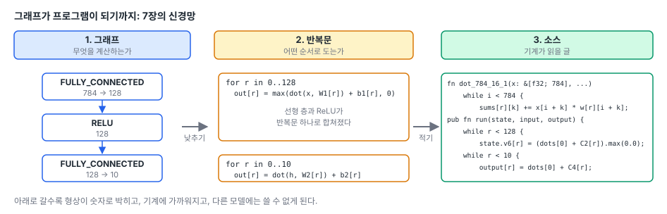
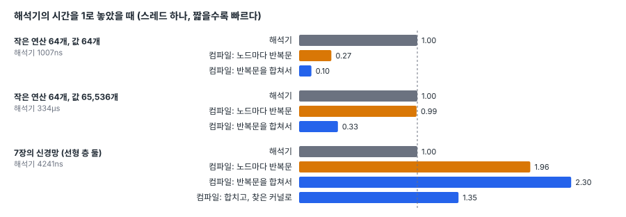
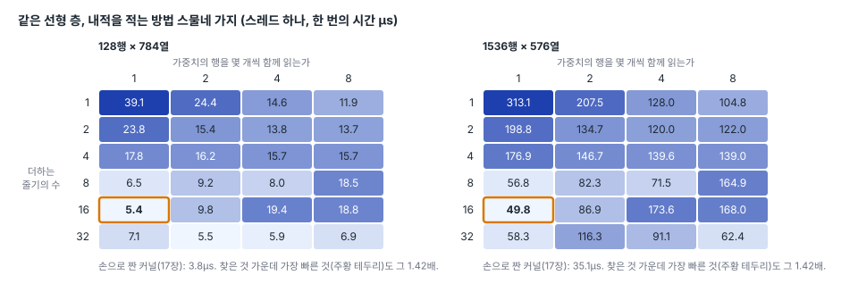

# ML 컴파일러

이 책의 첫 장은 추론 엔진을 셋으로 나눴습니다. 모델을 **코드로 직접**
쓰는 엔진, 모델 파일의 **그래프를 해석**하는 엔진, 모델을 **컴파일**하는
엔진. 첫째는 2부에서, 둘째는 4부에서 만들었습니다. 셋째 칸에는 "52장에서
설명"이라고만 적었습니다.

그 뒤로 컴파일러를 두 번 만났습니다. [50장](../part6/ch50_web_ecosystem.md)에서 WebLLM은 모델을 미리
컴파일한 코드를 브라우저에 내려보냈고, 큰 모델에서 우리를 앞섰습니다.
[51장](ch51_why_not_pytorch.md)에서 `torch.compile`은 Python 안에서 모델을 기계어로 옮겼고,
ExecuTorch는 "미리 컴파일"이라는 말을 문서의 첫머리에 썼습니다.

이 장은 그 셋째 칸을 채웁니다. 설명만 하지 않습니다. 이 책의 방법대로
**작은 것을 하나 만들어 보고, 재 보고, 그다음에 진짜를 읽습니다.**

- [26장](../part4/ch26_graph_interpreter.md)의 그래프를 받아 **Rust 소스를 내는 컴파일러**를 만듭니다. 300줄쯤
  입니다.
- 같은 그래프를 해석기와 컴파일한 프로그램으로 돌려 **무엇이 빨라지고
  무엇이 빨라지지 않는지** 잽니다.
- 내적 커널의 생김새를 바꿔 가며 **가장 빠른 것을 찾게** 합니다. 실제
  컴파일러들이 "자동 튜닝"이라고 부르는 일의 가장 작은 꼴입니다.
- [50장](../part6/ch50_web_ecosystem.md)에서 받아 둔 **WebLLM의 모델 코드를 열어** 진짜 컴파일러가 무엇을
  냈는지 읽습니다.
- 그 위에서 **TVM과 MLIR**을 설명합니다.

결과를 미리 적어 둡니다.

- 해석기가 마디 하나를 찾아 부르는 데 드는 값은 **11ns쯤**입니다.
  PyTorch가 연산 하나를 부르는 값(0.35µs, [51장](ch51_why_not_pytorch.md))의 30분의 1입니다.
- 작은 연산 64개가 이어진 그래프를 컴파일하면 **10배 빨라집니다.** 반복문
  64개가 하나로 합쳐지고, 가운데 값이 메모리에 한 번도 적히지 않습니다.
- [7장](../part1/ch07_mnist.md)의 신경망을 컴파일하면 **2배 느려집니다.** 시간이 내적에서 가고,
  컴파일러가 낸 내적이 [17장](../part3/ch17_simd.md)에서 손으로 짠 것보다 느리기 때문입니다.
- 내적을 적는 방법 스물네 가지를 재게 하면 가장 느린 것과 가장 빠른 것이
  **7배** 차이 납니다. 찾은 것으로 다시 컴파일해도 손으로 짠 커널의
  1.4배 시간입니다.
- WebLLM이 SmolLM2-135M을 위해 받는 코드에는 **셰이더가 86개** 들어
  있습니다. 글로 1.6MB입니다. 모델의 형상 576이 숫자로 박혀 있고,
  반복문이 풀려 있습니다.

## 52.1 해석과 컴파일

[26장](../part4/ch26_graph_interpreter.md)의 해석기가 하는 일을 다시 봅니다. 모델 파일에서 그래프를 읽습니다.
실행할 순서를 정합니다. 그리고 마디마다 이렇게 합니다.

1. 이 마디의 연산자가 무엇인지 본다.
2. 그 연산자의 커널을 찾는다.
3. 입력과 출력이 놓인 자리를 찾는다.
4. 커널을 부른다.

커널은 엔진을 만들 때 이미 기계어로 옮겨져 있습니다. **어떤 모델이 올지
모르는 채로** 옮겨졌습니다. 그래서 커널은 형상을 인자로 받고, 반복문의
끝을 변수로 둡니다. 선형 층의 커널은 784열짜리 가중치도 576열짜리
가중치도 같은 기계어로 계산합니다.

컴파일러는 순서를 바꿉니다. **모델을 먼저 보고, 그 모델만 계산하는
프로그램을 냅니다.** 위의 1번부터 3번까지를 미리 해 버립니다. 남는 것은
4번, 계산뿐입니다. 그리고 모델을 보았으므로 할 수 있는 일이 더 생깁니다.

- 형상을 **숫자로 박습니다.** 반복문의 끝이 784라는 것을 아는 채로
  기계어를 만듭니다.
- 이어지는 연산을 **하나로 합칩니다.** 이 모델에서 이 연산 뒤에 저 연산이
  온다는 것을 알기 때문입니다.
- 이 모델의 이 층에 맞는 커널을 **찾아서 만듭니다.**

치르는 것도 있습니다. 모델이 바뀌면 다시 컴파일해야 합니다. 컴파일러
자체가 큰 프로그램입니다. 그리고 낸 프로그램이 틀렸을 때 까닭을 찾기가
어렵습니다. [1장](../part1/ch01_landscape.md)의 표에 적은 대로입니다.

이 구분은 깔끔하지 않습니다. 우리 해석기도 실행 전에 그래프를 고쳐
씁니다([30장](../part4/ch30_graph_optimization.md)). 합성곱과 배치 정규화를 합치고, 활성화 함수를 앞의 연산에
접어 넣었습니다. 컴파일러가 하는 일의 일부를 이미 한 것입니다. 그래도 한
가지는 하지 않았습니다. **새 기계어를 만들지 않았습니다.** 커널은 엔진에
든 것 그대로였습니다. 이 장의 "컴파일"은 거기를 넘는 일입니다.

## 52.2 해석의 값

컴파일러가 없애 주는 것이 얼마인지부터 잽니다. 해석기가 마디 하나마다
치르는 값입니다.

그 값만 보이는 그래프를 짓습니다. 작은 연산 64개가 한 줄로 이어집니다.
더하기, 곱하기, ReLU, 자르기를 돌아가며 놓습니다. 큰 모델에서 선형 층과
선형 층 사이를 잇는 일들을 흉내 낸 것입니다.

```rust
{{#include ../../../crates/badak_graph/examples/ch52_compile.rs:glue}}
```

값이 64개일 때 해석기는 이 그래프를 한 번 도는 데 **1,007ns**가 걸립니다.
마디 하나에 16ns입니다. 값 64개에 더하기를 하는 데는 그만큼 들지
않습니다. 나머지는 찾고 부르는 값입니다. 얼마가 계산이고 얼마가 찾는
값인지는 뒤에서 같은 계산을 컴파일해 보면 드러납니다.

숫자를 미리 놓아 둡니다. 해석기 1,007ns, 컴파일한 것 275ns. 차이
732ns를 64로 나누면 **마디 하나에 11ns**입니다. 이것이 [26장](../part4/ch26_graph_interpreter.md)의 해석기가
"이 마디는 무엇이고 값은 어디에 있는가"에 쓰는 시간입니다.

작습니다. [51장](ch51_why_not_pytorch.md)에서 잰 PyTorch의 값은 연산 하나에 0.35µs였습니다. 그
30분의 1입니다. PyTorch는 연산마다 Python을 지나고, 형을 확인하고,
자동 미분을 살피고, 출력 텐서를 새로 만듭니다. 우리 해석기는 실행 전에
그 일을 끝내 두었습니다. **해석기도 이미 많은 것을 "미리" 합니다.**

그러면 11ns는 언제 문제가 됩니까. 마디가 하는 계산이 11ns보다 그리
크지 않을 때입니다. 값이 수십 개인 연산이 수천 개 이어지는 모델이
그렇습니다. 값이 수십만 개인 선형 층에서는 보이지 않습니다.

## 52.3 세 층의 표현

이제 컴파일러를 만듭니다. `crates/badak_graph/src/codegen.rs`입니다.

그래프에서 소스로 한 번에 가지 않습니다. 가운데에 표현을 하나 둡니다.



1. **그래프.** "이 값에 이 연산을 한다." [26장](../part4/ch26_graph_interpreter.md)의 `Graph` 그대로입니다.
2. **반복문.** "이 길이만큼 돌면서 원소마다 이 식을 계산한다."
3. **소스.** Rust의 글.

가운데 층이 왜 필요합니까. 그래프의 말로는 "더하기 다음에 ReLU"라고만 할
수 있습니다. 둘을 합친다는 것을 적을 말이 없습니다. 소스의 말로는 무엇이든
적을 수 있지만, 글을 다시 읽어 고치기는 어렵습니다. **반복문과 식**으로
적어 두면 합치기가 "식을 식에 넣는다"는 간단한 일이 됩니다.

실제 컴파일러들이 중간 표현(intermediate representation, IR)을 여러 층으로
두는 까닭이 이것입니다. 층마다 할 수 있는 일이 다릅니다. 뒤에서 볼
TVM은 그래프의 층과 반복문의 층을 두고, MLIR은 층을 마음대로 만들어 쌓게
해 줍니다.

가운데 층은 이렇게 생겼습니다.

```rust
{{#include ../../../crates/badak_graph/src/codegen.rs:ir}}
```

반복문은 두 가지뿐입니다. 원소마다 식 하나를 계산하는 `Map`, 그리고 행마다
내적을 하는 `Linear`. `Linear`에는 `post`라는 식이 달려 있습니다. 내적에
치우침을 더한 값에 이어서 할 일입니다. 처음에는 "그대로 둔다"이고,
합치기가 여기에 ReLU를 넣게 됩니다.

그래프를 이 층으로 **낮춥니다**(lowering). 마디 하나가 반복문 하나가
됩니다.

```rust
{{#include ../../../crates/badak_graph/src/codegen.rs:lower}}
```

아는 연산이 여섯입니다. 모르는 연산을 만나면 거절합니다. 해석기는
22가지를 압니다. **컴파일러를 쓸모 있게 만드는 일의 대부분은
이 표를 채우는 일**이고, 그것은 해석기의 커널을 채우는 일과 크기가
같습니다.

## 52.4 반복문 합치기

낮춘 직후에는 얻은 것이 없습니다. 마디 64개가 반복문 64개가 됐을
뿐입니다. 이제 **합칩니다**(fusion).

규칙은 하나입니다. 앞 반복문이 쓴 값을 **바로 뒤 반복문만** 읽고 길이가
같으면, 뒤의 식에서 그 값을 읽는 자리에 앞의 식을 통째로 넣습니다.

```rust
{{#include ../../../crates/badak_graph/src/codegen.rs:fuse}}
```

`a = x + 1`, `b = max(a, 0)`이 있으면 `b = max(x + 1, 0)`이 됩니다. `a`는
어디에도 적히지 않습니다. 얻는 것이 둘입니다.

- **메모리를 오가지 않습니다.** 반복문이 둘이면 `a`를 메모리에 다 적고 다시
  다 읽습니다. 하나이면 값이 레지스터에 머뭅니다.
- **가운데 값의 자리가 없어집니다.**

조건이 중요합니다. `a`를 읽는 곳이 둘이면 합치지 않습니다. 합치면 `x + 1`을
두 번 계산하게 됩니다. 시험 하나가 이것을 지킵니다
(`a_value_read_twice_is_not_fused_away`).

24.7절에서 같은 일을 손으로 했습니다. MLP의 활성화 함수와 곱셈을 반복문
하나로 합쳐 썼습니다. [30장](../part4/ch30_graph_optimization.md)에서는 그래프의 층에서 했습니다. "합성곱 뒤의 ReLU"처럼
**미리 아는 짝**만 합칠 수 있었습니다. 커널이 그 짝을 위해 이미 있어야
했기 때문입니다. 지금은 아무 짝이나 합칩니다. 합친 것을 계산할 기계어를
새로 만들 것이기 때문입니다. 이것이 컴파일하는 쪽의 차이입니다.

[7장](../part1/ch07_mnist.md)의 신경망이 세 층을 지나는 모습입니다.

```text
{{#include ../../../bench/ch52/ir.txt:1:8}}
```

마디 셋이 반복문 셋이 되고, ReLU가 첫 선형 층의 `post`로 들어가 둘이
됩니다. `Clamp(Input(0), 0.0, inf)`가 ReLU입니다.

## 52.5 소스로 적기

마지막 층입니다. 반복문을 Rust의 글로 적습니다.

```rust
{{#include ../../../crates/badak_graph/src/codegen.rs:emit}}
```

`format!`으로 글을 이어 붙이는 것이 전부입니다. 눈여겨볼 것은 **무엇이
숫자가 되는가**입니다. 64개짜리 그래프를 합쳐서 낸 소스는 이렇습니다(상수
배열은 줄였습니다).

```rust
static C1: [f32; 64] = [-0.06, 0.010000002, /* ... */];
static C2: [f32; 64] = [1.0, 1.02, /* ... */];
pub struct State {
}
pub fn run(state: &mut State, input: &[f32; 64], output: &mut [f32; 64]) {
    for i in 0..64 {
        let value = ((((input[i] + C1[i]) * C2[i]).max(0.0_f32).max(0.0_f32).min(2.0_f32) + C1[i]) /* ... 열여섯 번 */;
        output[i] = value;
    }
}
```

- 길이 64가 **형에 박혔습니다.** `&[f32; 64]`. Rust의 컴파일러는 반복이
  정확히 64번이라는 것, 배열을 벗어나는 일이 없다는 것을 압니다.
- 가중치가 **프로그램의 일부**가 됐습니다. `static` 배열입니다.
- 마디 64개가 **식 하나**입니다. `State`가 비어 있습니다. 가운데 값이
  하나도 없습니다.

이 소스를 `rustc`가 기계어로 옮깁니다. 우리 컴파일러는 기계어를 직접 내지
않습니다. 실제 ML 컴파일러들도 대개 그렇게 합니다. 마지막 단계는 LLVM
같은 기존의 컴파일러에 맡기거나, GPU라면 셰이더의 글을 내고 드라이버에
맡깁니다. **ML 컴파일러의 일은 "기계어를 만드는 것"이 아니라 "기존
컴파일러가 잘 옮길 수 있는 꼴로 모델을 적어 주는 것"**에 가깝습니다.

선형 층은 내적 함수를 따로 냅니다.

```rust
{{#include ../../../crates/badak_graph/src/codegen.rs:dot}}
```

[16장](../part3/ch16_matmul.md)과 [17장](../part3/ch17_simd.md)에서 배운 두 가지가 인자로 들어 있습니다. 합을 변수 몇
개에 나누어 담아 더하는가(`accumulators`), 가중치의 행을 몇 개씩 함께
읽는가(`rows`).
이 둘을 어떻게 정하느냐가 뒤에서 이야기가 됩니다.

## 52.6 재 보기

해석기와 컴파일한 프로그램을 같은 입력으로 돌립니다. 스레드는 하나만
씁니다. 우리 컴파일러가 스레드를 쓰는 코드를 내지 않으므로 해석기도 하나로
맞췄습니다. 아홉 묶음을 돌려 가장 빨랐던 묶음을 적습니다.

```text
{{#include ../../../bench/ch52/compile.txt:21:26}}
```



**값이 64개일 때.** 컴파일만 해도 3.7배 빨라집니다(1,007ns → 275ns).
합치지 않았으니 반복문은 여전히 64개입니다. 없어진 것은 찾고 부르는
값뿐입니다. 앞 절의 11ns가 여기에서 나왔습니다. 합치면 다시 2.6배
빨라집니다(105ns). 모두 **10배**입니다. 답은 비트까지 같습니다.

**값이 65,536개일 때.** 컴파일만 해서는 달라지는 것이 없습니다(0.99배).
마디 하나의 계산이 5µs이니 11ns는 보이지 않습니다. 숫자를 하나 더
봅니다. **가운데 값의 자리**입니다. 해석기는 입력과 출력까지 넣어
0.5MB를 씁니다. 메모리
계획([26장](../part4/ch26_graph_interpreter.md))이 수명이 끝난 자리를 다시 쓰고, [30장](../part4/ch30_graph_optimization.md)의 "제자리 계산"이 결과를
입력의 자리에 적기 때문입니다. 우리 컴파일러가 마디마다 낸 프로그램은
16.5MB를 씁니다. 값마다 자리를 따로 잡았습니다. 메모리 계획을 만들지
않았으니까요. **해석기가 하던 일은 컴파일러에서도 누군가 해야 합니다.**

합치면 3배 빨라집니다(334µs → 110µs). 자리는 0바이트입니다. 큰 값에서
합치기가 주는 것은 찾는 값이 아니라 **메모리를 64번 오가던 것을 한 번으로
줄인 것**입니다.

**[7장](../part1/ch07_mnist.md)의 신경망.** 컴파일한 쪽이 **2배 느립니다.**

```text
{{#include ../../../bench/ch52/compile.txt:17:19}}
```

마디가 셋뿐이니 찾는 값은 30ns 남짓입니다. 4,241ns 가운데 나머지는
내적입니다. 784개짜리 내적 128번과 128개짜리 내적 10번. 그리고 우리
컴파일러가 낸 내적은 해석기가 부르는 내적보다 느립니다.

해석기의 커널은 [17장](../part3/ch17_simd.md)에서 손으로 짰습니다. NEON 명령을 골라 쓰고, 합의
수와 한 번에 읽는 행의 수를 재 가며 정했습니다. 컴파일러가 낸 것은 앞
절의 `write_dot`입니다. 평범한 Rust의 반복문이고, 합 8개에 행 4개라는
수는 제가 어림으로 적은 것입니다.

합친 쪽이 합치지 않은 쪽보다도 느린 것(2.30배 대 1.95배)도 보입니다. 세
번을 다시 재도 같았습니다. 두 소스는 같은 내적 함수를 부르고, 다른 것은
ReLU를 내적 바로 뒤에 하느냐 반복문을 따로 도느냐뿐입니다. `rustc`가 두
소스를 다르게 옮긴 것인데, 기계어를 견줘 까닭을 찾지는 않았습니다. 하나는
말할 수 있습니다. **합치기가 늘 이기지는 않습니다.** 실제 컴파일러들이
규칙만 믿지 않고 재 보는 까닭입니다.

여기까지의 교훈은 이 책이 여러 번 만난 것과 같습니다. **시간이 가는 곳을
고쳐야 빨라집니다.** 컴파일은 연산과 연산 사이의 값을 없애 줍니다. 시간이
연산 안에서 가면 컴파일해도 그대로이고, 커널이 못하면 더 느려집니다.

## 52.7 커널 찾기

그러면 컴파일러는 좋은 커널을 어디에서 얻습니까. 길이 둘입니다.

하나는 **가져다 쓰는 것**입니다. 손으로 짠 커널을 부르는 코드를 냅니다.
이렇게 하면 내적은 해석기와 같은 빠르기가 되고, 컴파일로 얻는 것은
연산 사이의 값뿐입니다.

다른 하나는 **찾는 것**입니다. 커널을 적는 방법을 여러 가지 만들어 놓고,
이 모델의 이 층의 형상으로, 이 기계에서, 하나씩 돌려 봅니다. 가장 빠른
것을 씁니다. 우리 컴파일러에는 고를 것이 둘 있었습니다. 합의 수 여섯
가지와 함께 읽는 행의 수 네 가지. 스물네 가지를 모두 잽니다.

```rust
{{#include ../../../crates/badak_graph/examples/ch52_compile.rs:search}}
```



같은 계산을 적는 방법에 따라 **7배**가 갈립니다(39.1µs와 5.4µs). 그리고
규칙이 단순하지 않습니다.

- 합이 하나이면 가장 느립니다. [16장](../part3/ch16_matmul.md)에서 본 대로입니다. `f32`의 덧셈은
  순서를 바꾸면 답이 달라질 수 있어서 `rustc`가 스스로 합을 나누지
  못합니다. 앞의 덧셈이 끝나야 다음 덧셈을 시작합니다.
- 합을 늘리면 빨라지다가, 행을 여럿 함께 읽는 것과 겹치면 다시
  느려집니다. 합 16개에 행 4개씩은 19.4µs입니다. 그런데 합 32개에 행
  4개씩은 다시 5.9µs입니다. `rustc`가 생김새마다 다르게 옮긴 것이고,
  기계어를 하나씩 견줘 보지는 않았습니다.
- 어림으로 적었던 합 8개, 행 4개는 8.0µs였습니다. 찾은 것의 1.5배
  시간입니다.

이 표를 사람이 미리 알기는 어렵습니다. 기계가 바뀌면 표도 바뀝니다.
그래서 **재서 고릅니다.**

찾은 생김새로 신경망을 다시 컴파일합니다.

```text
{{#include ../../../bench/ch52/compile.txt:20}}
```

2.30배에서 **1.35배**로 내려옵니다. 그래도 해석기보다 느립니다. 찾은
것 가운데 가장 빠른 커널도 손으로 짠 커널의 1.42배 시간이었으니까요.
우리가 찾아본 곳이 좁았습니다. 스물네 가지 안에는 [17장](../part3/ch17_simd.md)의 커널이 쓴
방법(NEON 명령을 직접 고르기, 남는 원소를 다루는 방법, 미리 읽어 두기)이
들어 있지 않습니다. **찾기는 찾아볼 곳 안에 있는 것만 찾습니다.**

실제 컴파일러의 찾기는 규모가 다릅니다. TVM의 논문 하나는 텐서 연산의
구현을 "수십억 가지의 프로그램 변종" 위에서 찾는다고 적습니다.[^autotvm]
반복문을 어떤 순서로 돌지, 얼마씩 끊어 돌지, 어디를 풀어 쓸지, 어디를
벡터로 옮길지, 어느 반복문을 스레드에 나눌지가 모두 고를 것입니다.
수십억 가지를 다 돌려 볼 수는 없으므로 **돌려 보지 않고 빠르기를 짐작하는
모델**을 학습시켜 유망한 것만 실제로 잽니다. 뒤이은 Ansor는 사람이
찾아볼 곳의 틀을 적어 주지 않아도 되게 했습니다.[^ansor] 저는 두 논문을
초록까지만 읽었습니다.

우리의 스물네 번은 소스를 컴파일하고 재는 데 40초쯤 걸렸습니다. 형상
하나에 그렇습니다. 층마다 형상이 다르면 층마다 다시 찾아야 합니다.
찾기는 **컴파일하는 시간을 늘려 실행하는 시간을 줄이는** 거래입니다.

## 52.8 진짜 컴파일러가 낸 것

우리 것은 장난감입니다. 진짜가 낸 것을 읽어 봅니다. 마침 손에 있습니다.

[50장](../part6/ch50_web_ecosystem.md)에서 WebLLM을 돌리려고 받은 파일 가운데 **모델의 코드**가
있었습니다. `SmolLM2-135M-Instruct-q0f16_cs1k-webgpu.wasm`, 6.3MB.
MLC LLM이 이 모델 하나를 컴파일해 낸 것입니다. MLC LLM은 스스로를 "LLM을
위한 ML 컴파일러이자 배포 엔진"이라고 소개하고,[^mlc] 컴파일은 TVM이
합니다. 이 파일 안에는 WebGPU의 셰이더가 글로 들어 있습니다. 꺼내서
셉니다(`reference/ch52_shaders.py`).

```text
{{#include ../../../bench/ch52/shaders.txt:1:6}}
```

**셰이더가 86개**, 글로 1.6MB입니다. 우리 엔진의 셰이더는 모두 일곱
개이고(`crates/badak_gpu/src/shaders/`) 모든 층이 함께 씁니다. 여기에는
행렬 곱만 서른 개입니다(`NT_matmul` 18개, `fused_NT_matmul…_add` 12개).
**층의 형상마다 커널이 따로** 나온 것입니다.

이름에서 읽을 수 있는 것들입니다.

| 이름 | 읽히는 것 |
|---|---|
| `NT_matmul` | 행렬 곱. 형상이 다른 곳마다 하나씩 |
| `fused_NT_matmul1_add` | 행렬 곱과 뒤의 더하기를 **합친** 커널 |
| `rms_norm` | 정규화([9장](../part2/ch09_transformer.md)) |
| `argsort`, `get_renorm_prob`, `take_sorted_probs` | **샘플링**([12장](../part2/ch12_sampling.md)). 확률을 정렬하고 자르는 일까지 GPU에서 한다 |
| `fused_dequantize1_NT_matmul` (4비트 모델) | **양자화를 푸는 일과 행렬 곱을 합친** 커널 |

마지막 줄은 Llama 3.2 1B의 4비트 파일에서 나옵니다. [20장](../part3/ch20_weight_quantization.md)에서 우리는
줄인 가중치를 풀어 놓지 않고 그대로 곱하는 커널을 손으로 짰습니다. 여기서는
컴파일러가 "풀기"와 "곱하기"를 합쳐서 같은 것을 냈습니다. 52.4절의
합치기가 실제로 쓰이는 모습입니다.

가장 짧은 행렬 곱 셰이더 하나를 열어 봅니다. 버퍼의 이름으로 보아 마지막
층, 은닉 벡터에서 어휘의 점수를 내는 곱입니다. 88줄 가운데 몇 줄입니다.

```wgsl
enable f16;

@group(0) @binding(0) var<storage, read_write> NT_matmul_ptr : array<f32>;
@group(0) @binding(1) var<storage, read> model_embed_tokens_weight3_ptr : array<f16>;
@group(0) @binding(2) var<storage, read> rms_norm121_ptr : array<f16>;

var<workgroup> red_buf0 : array<f32, 64>;
@compute @workgroup_size(64, 1, 1)
fn NT_matmul14_kernel(/* ... */) {
  /* ... */
  model_embed_tokens_weight3_local[0i] = model_embed_tokens_weight3_ptr[((v__1 * 576i) + i32(threadIdx.x))];
  NT_matmul_rf_local[0i] = fma(f32(rms_norm121_ptr[i32(threadIdx.x)]), f32(model_embed_tokens_weight3_local[0i]), NT_matmul_rf_local[0i]);
  model_embed_tokens_weight3_local_1[0i] = model_embed_tokens_weight3_ptr[(((v__1 * 576i) + i32(threadIdx.x)) + 64i)];
  /* ... */
```

사람이 쓴 코드가 아니라는 것이 보입니다. 읽히는 것들입니다.

- **`576i`.** SmolLM2-135M의 은닉 크기가 숫자로 박혀 있습니다. 우리
  셰이더(`linear_block.wgsl`)는 열의 수를 실행할 때 받았습니다.
- **버퍼의 이름이 모델의 것입니다.** `model_embed_tokens_weight3`,
  `rms_norm121`. 이 셰이더는 이 모델의 이 자리에서만 쓰입니다.
- **반복문이 없습니다.** `fma`가 아홉 번 적혀 있습니다. 576개를 스레드
  64개가 나눠 맡고, 스레드 하나가 9개(576 ÷ 64)를 더합니다. 9번 도는
  반복문을 컴파일러가 **풀어 썼습니다.** 형상을 알기 때문에 할 수 있는
  일입니다.
- 그 뒤에 `workgroupBarrier()`가 여덟 번 나옵니다. 스레드 64개가 가진
  합을 절반씩 접어 하나로 모으는 단계들입니다.
- 가중치가 `f16`입니다. 16비트 실수를 GPU에서 그대로 읽습니다.

86개가 다 이렇습니다. 가장 긴 것(`chunk_lse_kernel`)은 셰이더 하나가
4,716줄입니다.

[50장](../part6/ch50_web_ecosystem.md)의 측정을 다시 놓아 봅니다. Llama 3.2 1B에서 WebLLM은 초당 125토큰,
우리는 93토큰이었습니다. 그때 까닭을 "세 엔진은 모델 전체를 GPU에 두고
우리는 선형 층만 둔다"고 적었습니다. 그 "전체"가 이것입니다. 정규화도
잔차도 샘플링도 셰이더로 나와 있으니 값이 GPU를 떠나지 않습니다. 손으로
그렇게 하려면 연산마다 셰이더를 써야 합니다. [49장](../part6/ch49_browser_gpu.md)에서 우리는 그 일을
선형 층에서 멈췄습니다. **컴파일러는 그 일을 모델마다 대신 해 줍니다.**

치르는 것도 그 파일에 보입니다. 모델 하나에 6MB의 코드가 따로 있습니다.
우리 엔진의 브라우저용 모듈은 0.9MB였고 어떤 모델이든 읽었습니다([48장](../part6/ch48_browser.md)).
그리고 135M짜리 작은 모델에서는 WebLLM이 우리의 CPU보다 느렸습니다
(212 대 338토큰/초). 계산이 작으면 GPU를 오가는 값이 더 크기 때문이고,
이것은 컴파일과 상관없는 [49장](../part6/ch49_browser_gpu.md)의 이야기입니다.

## 52.9 TVM

**TVM**은 이 분야의 이름이 된 컴파일러입니다. 2018년의 논문은 문제를
이렇게 적습니다. 프레임워크들은 하드웨어 회사가 준 연산자 라이브러리에
기대고 서버용 GPU 몇 가지에만 맞춰져 있다. 폰, 임베디드 기기, 가속기 같은
새 플랫폼에 올리려면 사람의 손이 많이 든다.[^tvm]

이 책이 3부와 6부에서 겪은 일입니다. ARM의 CPU를 위해 NEON 커널을, x86을
위해 AVX2 커널을, GPU를 위해 셰이더를, 브라우저를 위해 WebAssembly의 SIMD
커널을 따로 썼습니다. 같은 선형 층을 네 번 썼습니다. TVM의 답은 **한 번 적고, 기계마다
컴파일하자**입니다.

논문이 내세우는 것은 두 층의 최적화입니다.[^tvm]

- **그래프의 층.** 연산자를 합칩니다(operator fusion). 52.4절의 일입니다.
- **연산자의 층.** 연산 하나를 반복문으로 적고, 그 반복문을 기계에 맞게
  바꿉니다. 그리고 그 바꾸기를 사람이 정하지 않고 **찾습니다.** 52.7절의
  일입니다.

우리가 만든 작은 것의 세 층이 이 구조를 따온 것입니다.

연산자의 층에서 TVM은 "무엇을 계산하는가"와 "어떻게 도는가"를 따로
적게 합니다. 이 생각은 사진 처리 언어 **Halide**에서 왔다고 알려져
있습니다. Halide의 소개 글은 스스로를 "고성능 이미지·배열 처리 코드를 쉽게
쓰게 해 주는 언어"라고 적습니다.[^halide] 계산의 뜻을 한 번 적어 두면,
도는 방법은 답을 바꾸지 않고 얼마든지 갈아 끼울 수 있습니다. 찾기가
가능해지는 것이 그 덕분입니다. 우리의 `write_dot`도 그랬습니다. 합의 수와
행의 수를 바꿔도 내적이라는 뜻은 그대로였습니다. (엄밀히는 `f32`의 덧셈
순서가 바뀌어 마지막 비트가 달라집니다. 위의 출력에서 "가장 큰 차이"가
4.8e-7에서 2.4e-7로 바뀐 것이 그것입니다.)

LLM은 TVM에 새 문제를 냈습니다. **형상이 실행할 때 정해집니다.** 프롬프트의
길이도, KV 캐시의 길이도 미리 알 수 없습니다. 지금의 TVM이 쓰는 표현인
**Relax**의 논문은 이것을 첫 문장에 적습니다. "동적 형상의 계산이 요즘의
ML에서, 특히 LLM에서 중요해졌다." Relax는 그래프, 반복문 수준의 텐서
프로그램, 바깥 라이브러리 호출을 한 표현 안에 담고, 형상을 기호로 적어
프로그램 전체에서 따라갑니다.[^relax] "길이가 n인 값"이라고 적어 두고
n이 무엇이든 맞는 코드를 내는 것입니다.

앞 절의 셰이더에서도 그것이 보였습니다. 은닉 크기 576은 숫자로
박혔지만, 어휘의 크기는 `podArgs.vocab_size`라는 실행 시의 인자로 남아
있었습니다. **아는 것은 박고, 모르는 것은 남깁니다.**

우리 컴파일러는 형상이 모두 정해진 그래프만 받습니다. 동적 형상은
컴파일러를 훨씬 어렵게 만드는 것 가운데 하나이고, 이 장에서는 만들지
않았습니다.

## 52.10 MLIR

TVM이 "ML을 위한 컴파일러"라면 **MLIR**은 "컴파일러를 만드는 재료"입니다.
LLVM 프로젝트의 일부이고, 논문의 제목이 뜻을 말합니다. "무어의 법칙이
끝나는 때를 위한 컴파일러 기반."[^mlir]

52.3절에서 우리는 표현을 세 층으로 뒀습니다. 그 층들을 손으로 정의했고,
층 사이를 옮기는 코드도 손으로 썼습니다. 컴파일러마다 이 일을 처음부터
다시 합니다. 프레임워크마다, 하드웨어 회사마다 자기 표현과 자기
변환기가 있습니다. 논문은 이것을 "소프트웨어의 파편화"라고 부르고, MLIR이 **서로 다른
추상화 수준의 코드 생성기와 변환기와 최적화기를 설계하고 구현하는 일을
돕는다**고 적습니다.[^mlir]

MLIR이 주는 것은 표현 하나가 아니라 **표현을 정의하는 방법**입니다. 층
하나를 방언(dialect)이라고 부릅니다. "텐서 연산의 방언", "반복문의 방언",
"어떤 가속기의 명령의 방언"을 같은 틀 안에서 정의하고, 한 프로그램 안에
섞어 쓰고, 위에서 아래로 조금씩 낮춥니다. 맨 아래에서 LLVM의 표현으로
이어져 기계어가 됩니다. (방언에 관한 이 문단은 MLIR의 문서로 널리 알려진
내용을 적은 것이고, 논문은 초록까지만 읽었습니다.)

MLIR 위에 지은 것들입니다.

- **IREE.** "MLIR에 바탕을 둔 컴파일러이자 런타임"이고, 모델을 하나의
  표현으로 낮춰 데이터센터에서 모바일과 에지까지 맞춘다고 소개합니다.[^iree]
  [1장](../part1/ch01_landscape.md)의 표에서 TVM 옆에 적은 이름입니다.
- **Torch-MLIR.** PyTorch에서 MLIR로 들어가는 문입니다. PyTorch 생태계에서
  MLIR 생태계로 가는 컴파일러 지원을 목표로 한다고 적습니다.[^torch-mlir]

이 책에서 MLIR로 무엇을 돌려 보지는 않았습니다.

## 52.11 해석기와 컴파일러 사이

지금까지 본 것을 한 줄에 놓습니다. 왼쪽일수록 실행할 때 하는 일이 많고
오른쪽일수록 미리 하는 일이 많습니다.

| | 실행할 때 정하는 것 | 미리 정하는 것 | 이 책에서 |
|---|---|---|---|
| PyTorch 즉시 실행 | 전부. 다음 연산이 무엇인지도 | 커널 | [51장](ch51_why_not_pytorch.md) |
| 그래프 해석기 | 어느 커널을 부를지 | 그래프, 순서, 메모리 계획, 커널 | 4부의 badak |
| + 그래프 최적화 | 〃 | 위에 더해, 아는 짝의 융합 | [30장](../part4/ch30_graph_optimization.md) |
| ExecuTorch | 〃 (델리게이트는 통째로) | 위에 더해, 계획을 **파일에** 적어 둔다 | [51장](ch51_why_not_pytorch.md) |
| `torch.compile` | 처음 부를 때 컴파일 | 그 뒤로는 기계어 | [51장](ch51_why_not_pytorch.md) |
| ML 컴파일러 (TVM, IREE) | 남겨 둔 형상 | 위에 더해, **모델마다의 기계어** | 이 장 |
| 코드로 직접 | 없음 | 사람이 모델을 코드로 썼다 | 2부의 badak, llama.cpp |

맨 아래 줄이 눈에 띕니다. **2부에서 우리는 사람이 컴파일러 노릇을
했습니다.** 트랜스포머의 층을 Rust의 함수로 직접 썼습니다. 그래프도
해석도 없었습니다. [24장](../part3/ch24_attention.md)에서 MLP의 연산 둘을 손으로 합쳤고, [20장](../part3/ch20_weight_quantization.md)에서
양자화 풀기와 내적을 손으로 합쳤습니다. llama.cpp가 하는 일이기도 합니다.
모델의 종류가 적고(LLM은 거의 같은 구조입니다) 그 구조가 중요하면 사람이
쓰는 쪽이 이깁니다. [13장](../part2/ch13_first_showdown.md)과 [25장](../part3/ch25_rematch.md)에서 견준 상대가 컴파일러가 아니라 손으로
쓴 엔진이었던 까닭입니다.

그러면 컴파일러는 언제 이깁니까. 이 장의 실험과 [50장](../part6/ch50_web_ecosystem.md)의 측정에서 읽히는
것은 셋입니다.

- **작은 연산이 많이 이어질 때.** 52.6절의 10배입니다. 해석의 값과
  메모리를 오가는 값이 계산보다 클 때.
- **기계가 여럿일 때.** 커널을 기계마다 손으로 쓰는 값이 컴파일러를
  만드는 값을 넘을 때. GPU가 특히 그렇습니다. 손으로 쓴 셰이더는 모델의
  일부에서 멈추기 쉽고(우리의 [49장](../part6/ch49_browser_gpu.md)), 값이 CPU와 GPU를 오가면 거기에서
  시간이 갑니다.
- **모델이 정해져 있을 때.** 제품에 모델 하나를 넣는다면 다시 컴파일하는
  불편은 없는 것과 같습니다.

지는 때도 같은 실험에 있습니다. 시간이 큰 커널 안에서 가고 손으로 짠
커널이 이미 있을 때입니다. 52.6절의 신경망입니다. 그래서 실제의
컴파일러들은 고집하지 않습니다. Relax가 "바깥 라이브러리 호출"을 표현
안에 넣은 것[^relax]이 그것이고, 손으로 짠 커널이 더 빠른 곳에서는 그것을
부르는 코드를 냅니다.

이 책이 해석기를 고른 까닭도 적어 둡니다. 목적이 **추론 엔진이 하는 일을
하나씩 꺼내 보는 것**이었기 때문입니다. 해석기에서는 커널, 메모리 계획,
그래프 최적화가 따로 떨어져 있어 하나씩 만들고 잴 수 있습니다.
컴파일러에서는 그것들이 낸 코드 안에 녹아 있습니다. 앞 절의 4,716줄짜리
셰이더처럼요. 배우기에는 해석기가 낫고, 이 장까지 온 독자는 컴파일러가
낸 코드를 읽으며 "이것은 융합이고, 이것은 펼친 반복문이고, 이것은 박힌
형상"이라고 가려낼 수 있습니다.

## 52.12 남긴 것

- **동적 형상.** 우리 컴파일러는 형상이 모두 정해진 그래프만 받습니다.
- **메모리 계획.** 가운데 값마다 자리를 따로 잡습니다. [26장](../part4/ch26_graph_interpreter.md)의 계획을
  컴파일러 쪽으로 옮기는 일은 연습 문제로 남깁니다.
- **연산자.** 여섯 가지만 압니다. 합성곱도 어텐션도 없습니다.
- **스레드와 SIMD 명령.** 낸 코드는 스레드 하나로 돌고, 벡터 명령은
  `rustc`가 알아서 넣는 만큼만 씁니다.
- **GPU.** 셰이더를 내지 않습니다. 읽기만 했습니다.
- **TVM, IREE를 직접 돌려 보는 일.** MLC가 컴파일해 둔 것을 읽었을 뿐,
  TVM으로 모델을 컴파일하지도 튜닝하지도 않았습니다. 그래서 "TVM이
  얼마나 빠른가"는 이 장이 답하지 않습니다. [50장](../part6/ch50_web_ecosystem.md)의 WebLLM 숫자가 이 책이
  가진 유일한 측정입니다.
- **합친 신경망이 합치지 않은 것보다 느린 까닭.** 찾지 않았습니다.

## 정리

- 해석기는 모델을 모르는 채로 만든 커널을 마디마다 찾아 부릅니다.
  컴파일러는 모델을 보고 그 모델만 계산하는 프로그램을 냅니다.
- 우리 해석기가 마디 하나에 치르는 값은 11ns쯤입니다. 연산이 작고 많을
  때만 보입니다.
- 컴파일러는 표현을 여러 층으로 둡니다. 그래프, 반복문, 소스. 층마다 할
  수 있는 일이 다르고, 융합은 반복문의 층에서 "식을 식에 넣는 일"입니다.
- 작은 연산 64개를 합치면 10배 빨라지고 가운데 값의 자리가 없어집니다.
- 선형 층이 시간을 쓰는 신경망은 컴파일해도 빨라지지 않습니다. 커널이
  속도를 정하고, 평범하게 낸 커널은 손으로 짠 것보다 느립니다.
- 커널을 적는 방법 스물네 가지가 7배 갈립니다. 실제 컴파일러는 훨씬 큰
  곳을, 빠르기를 짐작하는 모델의 도움으로 찾습니다.
- MLC가 SmolLM2-135M을 위해 낸 코드에는 셰이더가 86개 있습니다. 형상이
  박혀 있고, 반복문이 풀려 있고, 양자화 풀기와 행렬 곱이 합쳐져 있고,
  샘플링까지 GPU에 있습니다.
- TVM은 "한 번 적고 기계마다 컴파일한다"의 대표이고, MLIR은 그런
  컴파일러를 짓는 재료입니다.
- 2부의 badak과 llama.cpp는 사람이 컴파일러 노릇을 한 엔진입니다.

## 연습 문제

1. `cargo run --release -p badak_graph --example ch52_compile -- glue`를
   자기 기계에서 돌려 보십시오. `glue`의 깊이를 64에서 8과 512로 바꾸면
   해석기와 컴파일한 것의 비가 어떻게 달라집니까?
2. `codegen.rs`에 연산을 하나 더하십시오. 예를 들어 `Op::Tanh`. `Expr`,
   `lower`, `write_expr` 세 곳을 고치면 됩니다. 해석기와 답이 같은지
   확인하십시오.
3. `fuse`는 값을 읽는 곳이 둘이면 합치지 않습니다. 잔차 연결
   (`c = a + f(a)`)이 그런 경우입니다. `a`를 두 번 계산하지 않으면서
   반복문 하나로 만들려면 가운데 층에 무엇이 더 있어야 합니까?
   (`let`으로 값에 이름을 붙이는 식을 생각해 보십시오.)
4. 마디마다 컴파일한 `glue_65536`은 가운데 값에 16.5MB를 씁니다. [26장](../part4/ch26_graph_interpreter.md)의
   `memory::plan`을 `emit`에서 불러 자리를 다시 쓰게 해 보십시오. 시간이
   달라집니까?
5. `write_dot`에 고를 것을 하나 더하십시오. 예를 들어 "입력을 몇 개씩
   끊어 도는가". 찾아볼 곳이 몇 배가 됩니까? 모두 재는 데 걸리는 시간은
   어떻게 됩니까? 다 재지 않고 좋은 것을 찾으려면 어떻게 하겠습니까?
6. `python3 reference/ch52_shaders.py`를 고쳐 `rms_norm` 셰이더 하나를
   통째로 적게 하고 읽어 보십시오. [9장](../part2/ch09_transformer.md)의 RMSNorm 식이 어디에 어떻게
   적혀 있습니까?
7. 52.11절의 표에서 자기가 아는 엔진 하나(LiteRT, ONNX Runtime, Core ML)의
   자리를 찾아보십시오. [31장](../part4/ch31_mobile_engines.md)과 [45장](../part6/ch45_gpu_npu.md)에서 본 것을 떠올리십시오. 그 엔진은
   무엇을 미리 하고 무엇을 실행할 때 합니까?

## 참고 문헌

[^tvm]: Tianqi Chen 외, "TVM: An Automated End-to-End Optimizing Compiler
    for Deep Learning" (2018). arXiv:1802.04799.
    <https://arxiv.org/abs/1802.04799>. 초록까지만 읽었습니다. "Current
    frameworks rely on vendor-specific operator libraries and optimize for a
    narrow range of server-class GPUs", "a compiler that exposes graph-level
    and operator-level optimizations to provide performance portability",
    "high-level operator fusion". 지금의 저장소는 apache/tvm입니다(README,
    커밋 `05ac00e2efb6`. "an open machine learning compilation framework").

[^autotvm]: Tianqi Chen 외, "Learning to Optimize Tensor Programs" (2018).
    arXiv:1805.08166. <https://arxiv.org/abs/1805.08166>. 초록까지만
    읽었습니다. "We learn domain-specific statistical cost models to guide
    the search of tensor operator implementations over billions of possible
    program variants."

[^ansor]: Lianmin Zheng 외, "Ansor: Generating High-Performance Tensor
    Programs for Deep Learning" (2020). arXiv:2006.06762.
    <https://arxiv.org/abs/2006.06762>. 초록까지만 읽었습니다. "Ansor
    explores many more optimization combinations by sampling programs from a
    hierarchical representation of the search space. Ansor then fine-tunes
    the sampled programs with evolutionary search and a learned cost model".

[^relax]: Ruihang Lai 외, "Relax: Composable Abstractions for End-to-End
    Dynamic Machine Learning" (2023). arXiv:2311.02103.
    <https://arxiv.org/abs/2311.02103>. 초록까지만 읽었습니다. "Dynamic
    shape computations have become critical in modern machine learning
    workloads, especially in emerging large language models", "a cross-level
    abstraction that encapsulates computational graphs, loop-level tensor
    programs, and external library calls in a single representation",
    "first-class symbolic shape annotations".

[^mlir]: Chris Lattner 외, "MLIR: A Compiler Infrastructure for the End of
    Moore's Law" (2020). arXiv:2002.11054.
    <https://arxiv.org/abs/2002.11054>. 초록까지만 읽었습니다. "MLIR aims to
    address software fragmentation, improve compilation for heterogeneous
    hardware, significantly reduce the cost of building domain specific
    compilers", "facilitates the design and implementation of code
    generators, translators and optimizers at different levels of
    abstraction".

[^halide]: halide/Halide의 README (커밋 `54c1a9bd6733`).
    <https://github.com/halide/Halide/tree/54c1a9bd6733>. "Halide is a
    programming language designed to make it easier to write
    high-performance image and array processing code on modern machines."
    TVM이 계산과 도는 방법을 나누는 생각을 Halide에서 가져왔다는 것은 TVM
    논문의 본문에 있다고 알려진 내용이고, 저는 본문을 확인하지 않았습니다.

[^mlc]: mlc-ai/mlc-llm의 README (커밋 `f55364f19854`).
    <https://github.com/mlc-ai/mlc-llm/tree/f55364f19854>. "MLC LLM is a
    machine learning compiler and high-performance deployment engine for
    large language models." 읽은 모델 코드는 mlc-ai/binary-mlc-llm-libs의
    커밋 `5b7251f3bdce`에 있는 파일들입니다(`scripts/download_ch50.sh`).
    본문의 셰이더 조각은 그 가운데 SmolLM2-135M의 파일에서 꺼낸 몇
    줄입니다. 이 저장소에는 라이선스 파일이 없어서 파일을 이 책의 저장소에
    옮겨 두지 않았고, 센 숫자만 `bench/ch52/shaders.txt`에 적었습니다.

[^iree]: iree-org/iree의 README (커밋 `318812edbe0b`).
    <https://github.com/iree-org/iree/tree/318812edbe0b>. "an MLIR-based
    end-to-end compiler and runtime that lowers Machine Learning (ML) models
    to a unified IR that scales up to meet the needs of the datacenter and
    down to satisfy the constraints and special considerations of mobile and
    edge deployments."

[^torch-mlir]: llvm/torch-mlir의 README (커밋 `d95c1dce2804`).
    <https://github.com/llvm/torch-mlir/tree/d95c1dce2804>. "The Torch-MLIR
    project aims to provide first class compiler support from the PyTorch
    ecosystem to the MLIR ecosystem."
