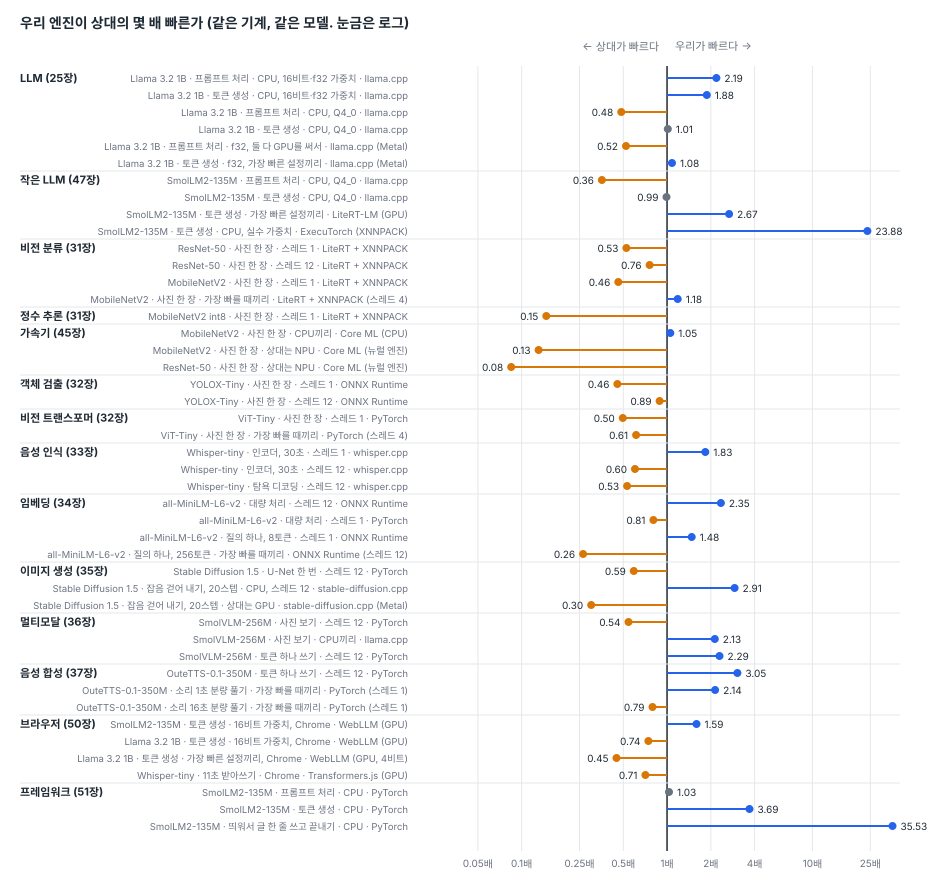

# 종합 성적표와 남은 길

[13장](../part2/ch13_first_showdown.md)에서 우리 엔진을 처음으로 실전
엔진 옆에 놓았습니다. 프롬프트 처리가 llama.cpp의 **2,600분의 1**, 토큰
생성이 53분의 1이었습니다. 그 숫자를 "원인별 조각의 곱"으로 나눴고,
3부가 조각을 하나씩 없앴습니다. 그 뒤로 4부에서 분야를 넓혔고, 5부에서
서버를, 6부에서 폰과 브라우저를 다뤘습니다. 장마다 그 분야의 실전 엔진과
견줬습니다.

이 장은 그 비교를 **한 표에 모읍니다.** 새로 재는 것은 없습니다. 앞
장에서 잰 숫자를 옮겨 한 표에 놓고, 세 가지를 합니다.

- **성적표.** 열네 갈래의 일, 마흔다섯 줄입니다. 어디에서 우리가 빠르고
  어디에서 상대가 빠른지 봅니다.
- **격차의 분류.** 상대가 빠른 줄을 까닭별로 묶습니다. 이 책의 계획이 이
  장에 맡긴 일입니다. "격차가 남는 지점은 숨기지 않고 원인별로
  분류한다."
- **남은 길.** 재지 못한 것, 만들지 않은 것, 그리고 독자가 여기에서
  무엇을 더 할 수 있는지 적습니다.

결과를 미리 적어 둡니다.

- 마흔다섯 줄 가운데 우리가 빠른 것이 **18줄**, 비슷한 것이 3줄, 상대가
  빠른 것이 **24줄**입니다.
- 우리가 빠른 곳은 대개 **작은 일이 이어지는 곳**과 **시작과
  크기**입니다. 토큰을 하나씩 쓰는 일, 짧은 글, 프로그램을 띄우는
  일입니다.
- 상대가 빠른 곳은 다섯 갈래로 묶입니다. 계산 전체를 GPU나 NPU에 올리지
  않은 것, 줄인 가중치의 커널, 스레드를 늘려도 덜 느는 커널, 커널 둘레의
  일, 그리고 상대가 쓰는 행렬 라이브러리입니다.
- 가장 크게 뒤지는 줄은 NPU와 견준 줄입니다(12분의 1). 가장 크게 앞서는
  줄은 프로그램을 띄워 글 한 줄을 쓰는 일입니다(36배).
- **이 표는 맥 한 대의 것입니다.** 폰에서도 x86에서도 데이터센터의
  GPU에서도 재지 못했습니다. 그것이 이 책의 가장 큰 빈칸입니다.

## 53.1 성적표는 재는 방법과 함께 읽는다

표를 보기 전에 읽는 규칙을 적습니다.
[14장](../part3/ch14_measurement.md)에서 배운 대로, 숫자는 재는 방법과
함께 읽어야 합니다.

**같은 기계, 같은 모델.** 모든 줄은 저자의 맥(M4 Max, 메모리 48GB)에서,
우리 엔진과 상대가 같은 모델을 계산한 것입니다. 답이 같은지는 장마다
먼저 확인했습니다(53.5절).

**옮겨 적은 숫자.** 줄마다 장 번호가 있습니다. 숫자는 그 장의 표에서
가져왔고, 재는 방법과 엔진의 버전은 그 장에 있습니다. 장마다 잰 날이
다르고 상대 엔진의 버전도 그때의 것입니다. 옮긴 숫자는
`bench/ch53/scorecard.tsv`에 있고, 아래의 표와 그림은 그 파일에서
만듭니다(`scripts/figures/ch53.py`).

**"몇 배 빠른가".** 마지막 열은 우리가 상대의 몇 배 빠른지입니다. 1보다
크면 우리가 빠르고(굵게 적었습니다) 작으면 상대가 빠릅니다. 0.5는 우리가
두 배 느리다는 뜻입니다. 0.95와 1.05 사이는 "비슷하다"로 셌습니다.

**조건.** 같은 일이라도 조건에 따라 순위가 바뀝니다. 그래서 한 모델에
여러 줄을 두었습니다. "스레드 1"과 "스레드 12", "CPU끼리"와 "가장 빠른
설정끼리"입니다. 뒤의 것은 엔진마다 자기에게 가장 좋은 설정을 골랐을
때입니다. 상대가 GPU를 쓰고 우리는 CPU를 쓰는 줄이 거기에 들어 있습니다.

**고른 줄.** 장마다의 표에는 줄이 훨씬 많습니다. 여기에는 그 장의 결론을
대표하는 줄을 제가 골랐습니다. 우리가 빠른 줄만 고르지 않으려고, 장마다
"스레드 하나"와 "가장 빠를 때"를 함께 넣는 것을 규칙으로 삼았습니다.
그래도 고른 것은 고른 것입니다. 한 줄이 의심스러우면 그 장의 표 전체를
봐야 합니다.

**우리 쪽의 "빠른 길".** [31장](../part4/ch31_mobile_engines.md)부터
우리 엔진에는 SME 커널을 쓰는 구현이 있습니다. 이 표의 4부 줄은 그
구현의 숫자입니다. 이 맥에 SME가 있어서 가능한 숫자이고, SME가 없는
프로세서에서는 NEON 커널의 숫자가 됩니다.

## 53.2 마흔다섯 줄을 한 표에 놓는다

{{#include ../../../bench/ch53/scorecard.md}}

[13장](../part2/ch13_first_showdown.md)의 줄을 이 표의 기준으로 적으면
**0.0004**입니다(2,600분의 1). 그림의 왼쪽 끝이 0.05이니 그림 밖으로
한참 나갑니다. 지금의 줄은 모두 0.08과 36 사이에 있습니다.

한 줄은 표에 없습니다. [25장](../part3/ch25_rematch.md)은 사람들이
실제로 쓰는 설정(4비트 가중치를 GPU에)의 llama.cpp와도 견줬고, 프롬프트
처리가 8.6배, 토큰 생성이 1.45배 느렸습니다. 우리는 4비트 가중치를 GPU에
올리지 못해 CPU로 돌린 숫자입니다.

## 53.3 우리가 빠른 줄을 까닭별로 묶는다

우리가 빠른 18줄을 까닭별로 묶습니다.

**연산을 부르는 비용이 없다.** PyTorch와 견준 줄에서 토큰을 하나씩 쓰는
일은 모두 우리가 빠릅니다. SmolLM2-135M
3.7배([51장](ch51_why_not_pytorch.md)), SmolVLM
2.3배([36장](../part4/ch36_multimodal.md)), OuteTTS
3.0배([37장](../part4/ch37_speech_synthesis.md))입니다.
[51장](ch51_why_not_pytorch.md)이 까닭을 쟀습니다. 토큰 하나에 PyTorch는
연산을 6,225번 부르고, 한 번에 0.35µs가 듭니다. 우리는 모델을 코드로
직접 썼으니 그 비용이 없습니다. 임베딩의 짧은 질의(1.5배,
[34장](../part4/ch34_embedding_search.md))도 같은 까닭입니다.

**시작이 가볍다.** 프로그램을 띄워 글 한 줄을 쓰고 끝내는 데 0.15초와
5.3초입니다(36배). 가중치를 파일에서 메모리로
비추고([22장](../part3/ch22_memory.md)), 띄울 것이 작기 때문입니다.
크기도 같은 경우입니다. 53.5절에 모았습니다.

**묶음을 스레드에 나눈다.** 임베딩의 대량 처리가 ONNX Runtime의
2.3배입니다([34장](../part4/ch34_embedding_search.md)). 커널이 빨라서가
아닙니다. 스레드 하나에서는 PyTorch가 우리보다 빠릅니다. 묶음 **안에서**
스레드를 나누지 않고 **묶음을** 스레드에 나눈 것이 더 빨랐습니다. 일의
구조를 아는 쪽이 할 수 있는 최적화입니다.

**같은 정밀도의 CPU 커널.** Llama 3.2 1B를 16비트·32비트 가중치로
CPU에서 돌리면 llama.cpp의 2배입니다([25장](../part3/ch25_rematch.md)).
[16장](../part3/ch16_matmul.md)과 [17장](../part3/ch17_simd.md)의 커널이
이 조건에서는 llama.cpp의 것보다 빠릅니다. 다만 이것은 llama.cpp가 공을
들이는 조건이 아닙니다. 사람들은 4비트로 줄여 GPU에서 돌립니다.

**스레드 하나의 SME.** Whisper의 인코더가 스레드 하나에서 whisper.cpp의
1.8배입니다([33장](../part4/ch33_speech_recognition.md)).
[31장](../part4/ch31_mobile_engines.md)에서 짠 SME 커널 덕입니다.
스레드를 늘리면 순위가 뒤집힙니다. 다음 절에 같은 모델이 다시 나옵니다.

**CPU끼리.** stable-diffusion.cpp의 CPU 구현(2.9배,
[35장](../part4/ch35_image_generation.md))과 llama.cpp의 CPU만 쓰는 비전
인코더(2.1배, [36장](../part4/ch36_multimodal.md))보다 빠릅니다. 두 엔진
모두 GPU가 기본이고, GPU로는 우리보다 훨씬 빠릅니다.

**조심해서 읽을 두 줄.** [47장](../part6/ch47_on_device_llm.md)의
LiteRT-LM(2.7배)과 ExecuTorch(24배)는 그 프로젝트가 **올려 둔 파일을
그대로** 돌린 것입니다. ExecuTorch의 파일은 32비트 실수에 KV 캐시의
방식도 달랐습니다. 엔진의 한계가 아니라 그 파일의 설정을 잰 숫자입니다.
엔진을 제대로 견주려면 같은 설정으로 모델을 내보내야 하고,
[47장](../part6/ch47_on_device_llm.md)은 거기까지 하지 않았습니다.

## 53.4 상대가 빠른 줄을 다섯 갈래로 나눈다

상대가 빠른 24줄입니다. [13장](../part2/ch13_first_showdown.md)이 한
것처럼 까닭별로 묶습니다.

먼저 밝혀 둡니다. **이 분류는 측정이 아니라 해석입니다.**
[13장](../part2/ch13_first_showdown.md)에서는 조건을 하나씩 바꿔 가며
조각마다의 크기를 쟀습니다. 여기서는 장마다 적어 둔 "남긴 것"과 그 장의
실험을 근거로 줄을 갈래에 넣었습니다. 한 줄에 까닭이 둘 이상 섞인 경우가
많고, 그 비율을 재지는 않았습니다.

| 갈래 | 그 줄들 (우리가 몇 배 빠른가) | 근거 |
|---|---|---|
| 1. 계산 전체를 GPU·NPU에 올리지 않았다 | Core ML 뉴럴 엔진 0.08, 0.13 · stable-diffusion.cpp Metal 0.30 · llama.cpp Metal 프롬프트 0.52 · WebLLM 0.74 | 45, 35, 25, [50장](../part6/ch50_web_ecosystem.md) |
| 2. 줄인 가중치의 커널 | 정수 MobileNetV2 0.15 · `Q4_0` 프롬프트 0.48, 0.36 · WebLLM 4비트 0.45 | 31, 25, 47, [50장](../part6/ch50_web_ecosystem.md) |
| 3. 스레드를 늘려도 덜 는다 | 긴 질의 0.26 · Whisper 인코더 스레드 12개 0.60 · ResNet-50 스레드 12개 0.76 · YOLOX 스레드 12개 0.89 | 34, 33, 31, [32장](../part4/ch32_vit_detection.md) |
| 4. 커널 둘레의 일 | 작은 LLM의 프롬프트 0.36 · ResNet-50, MobileNetV2, YOLOX 스레드 1개 0.46~0.53 · ViT 0.50 · Whisper 디코딩 0.53 | 47, 31, 32, [33장](../part4/ch33_speech_recognition.md) |
| 5. 상대가 Apple의 행렬 라이브러리를 쓴다 | SmolVLM 사진 보기 0.54 · U-Net 0.59 · ViT 0.61 · 임베딩 스레드 1개 0.81 · 소리 16초 풀기 0.79 | 36, 35, 32, 34, [37장](../part4/ch37_speech_synthesis.md) |

하나씩 봅니다.

### 1. 계산 전체를 GPU·NPU에 올리지 않았다

가장 큰 격차가 여기에 있습니다. [45장](../part6/ch45_gpu_npu.md)에서
Core ML은 뉴럴 엔진으로 MobileNetV2를 0.40ms에 끝냈습니다. 우리 CPU는
3.06ms입니다. 같은 CPU끼리는 비슷합니다(1.05). **차이는 엔진이 아니라
계산하는 장치입니다.**

우리 엔진이 GPU에 올린 것은 선형
층뿐입니다([23장](../part3/ch23_gpu.md),
[49장](../part6/ch49_browser_gpu.md)). 나머지는 CPU에 남고, 값이 둘
사이를 오갑니다. llama.cpp의 Metal 구현, stable-diffusion.cpp의 Metal
구현, WebLLM은 모델 전체를 GPU에 둡니다.
[25장](../part3/ch25_rematch.md)은 이것을 "4부의 그래프가 필요한
일"이라고 적었고, [50장](../part6/ch50_web_ecosystem.md)은 큰 모델에서
WebLLM보다 느린 까닭으로 들었고, [52장](ch52_ml_compilers.md)에서 그
"전체"가 셰이더 86개라는 것을 봤습니다.

이 갈래를 없애는 방법은 셋입니다. 연산마다 셰이더를 손으로
쓰거나(llama.cpp가 한 일), 컴파일러를 만들거나(MLC가 한 일),
[45장](../part6/ch45_gpu_npu.md)처럼 운영체제의 엔진에 통째로 넘기는
것입니다. 마지막 방법은 그때 본 대로 **연산 하나만 못 넘겨도** 얻는 것이
사라집니다(ResNet-50에서 더하기를 못 넘기자 1.04ms가 16ms가 됐습니다).

### 2. 줄인 가중치의 커널이 느리다

토큰 생성은 `Q4_0`에서 llama.cpp와 같습니다(1.01, 0.99). 그런데 프롬프트
처리는 절반입니다(0.48). [25장](../part3/ch25_rematch.md)이 까닭을
찾았습니다. 한 번에 내적을 몇 개 계산하느냐입니다. 토큰을 하나씩 쓸 때는
가중치를 메모리에서 읽어 오는 시간이 속도를 정하고, 여러 토큰을 한꺼번에
읽을 때는 커널의 계산이 정합니다. 우리의 줄인 가중치용 커널은 앞의
경우에만 빠릅니다.

정수 추론은 차이가 더 큽니다. MobileNetV2 int8이 XNNPACK의 7분의
1입니다. [31장](../part4/ch31_mobile_engines.md)에서 22.4ms를 11.5ms로
줄였지만 XNNPACK은 1.7ms입니다. 깊이별 합성곱의 정수 커널을 값 하나씩
계산한 채로 두었고([31장](../part4/ch31_mobile_engines.md)), SME의 정수
명령은 쓰지 않았습니다.

브라우저에서는 줄인 가중치를 쓰는 구현 자체가 없습니다.
[50장](../part6/ch50_web_ecosystem.md)에서 WebLLM은 4비트로 207토큰/초를
냈고, 우리는 16비트로만 돌았습니다.

이 갈래는 **지금의 구조로 고칠 수 있는 일**입니다.
[25장](../part3/ch25_rematch.md)도 그렇게 적었습니다. 커널을 더 짜면
됩니다.

### 3. 스레드를 늘려도 덜 는다

스레드 하나에서 앞서던 Whisper의 인코더가 스레드 열둘에서는
뒤처집니다(1.83 → 0.60). 임베딩의 긴 질의는 스레드를 늘려도 16ms
그대로이고, ONNX Runtime은 4.3ms로 내려갑니다.

[31장](../part4/ch31_mobile_engines.md)이 이것을 쟀습니다. NEON 커널은
스레드 열둘에서 10.6배가 되고, SME 커널은 2.8배에 그칩니다. 그리고
우리의 SME 커널 가운데 일부는 아예 스레드에 나누지 않았습니다.
[32장](../part4/ch32_vit_detection.md)과
[34장](../part4/ch34_embedding_search.md)의 "남긴 것"에 "SME 커널을
스레드에 나누기"가 그대로 적혀 있습니다.

SME가 왜 덜 느는지는 **확인하지 못했습니다.**
[31장](../part4/ch31_mobile_engines.md)에서 코어들이 SME 장치를 나눠
쓰는 것이 아닌가 짐작했을 뿐입니다. 상대 엔진도 같은 한계에 걸려
있습니다. [31장](../part4/ch31_mobile_engines.md)의 표에서 SME를 쓰는
엔진은 스레드 열둘에서 1.0~1.6배만 빨라졌습니다. 그래서 이 갈래의 줄에는
스레드가 많을 때 격차가 줄어드는 것(ResNet-50이 0.53에서 0.76으로)과
벌어지는 것(Whisper)이 섞여 있습니다.

### 4. 커널 둘레의 일이 느리다

커널이 빨라지면 커널이 아닌 것이 드러납니다. 이 책에서 여러 번 본
일입니다.

- **작은 모델의 프롬프트 처리.** SmolLM2-135M에서 llama.cpp가 우리의 세
  배입니다([47장](../part6/ch47_on_device_llm.md)). 1B 모델에서는 두
  배였습니다. 모델이 작을수록 곱셈 둘레의 일(텐서를 만들고, 값을 옮기고,
  정규화하는 일)이 차지하는 비중이 커집니다.
  [47장](../part6/ch47_on_device_llm.md)은 이것을 발견만 하고 더
  조사하지 않았습니다.
- **합성곱의 준비.** [31장](../part4/ch31_mobile_engines.md)에서 SME
  커널로 ResNet-50을 여섯 배 빠르게 한 뒤, 창을 늘어놓는 복사가 병목이
  됐습니다. XNNPACK은 그 복사를 없앤 방법(간접 합성곱)만 씁니다. 우리는
  복사를 줄였을 뿐 없애지 못했습니다.
- **ViT의 텐서.** [32장](../part4/ch32_vit_detection.md)의 남긴 것에
  "텐서 할당 줄이기"가 있습니다.
- **디코딩.** Whisper의 디코더는 토큰마다 작은 계산을 하고,
  whisper.cpp가 두 배 빠릅니다. 인코더를 고치는 데 시간을 썼고 디코더는
  보지 않았습니다.

이 갈래는 큰 발견이 필요한 일이 아닙니다. 프로파일러를
켜고([14장](../part3/ch14_measurement.md)) 하나씩 없애는 일입니다. 실전
엔진과 우리 엔진의 차이 가운데 가장 **시간을 들여야만 메울 수 있는**
부분이기도 합니다. 그 엔진에는 여러 해 동안 많은 사람이 이 일을 한
결과가 쌓여 있습니다.

### 5. 상대가 Apple의 행렬 라이브러리를 쓴다

PyTorch와 견준 줄 가운데 **큰 계산**은 대개 PyTorch가 빠릅니다. 사진을
보는 비전 인코더, U-Net, ViT, 긴 소리를 푸는 디코더입니다.
[51장](ch51_why_not_pytorch.md)이 확인한 대로 이 맥의 PyTorch는 큰 행렬
곱을 Apple의 Accelerate에 맡깁니다. 스레드 하나로도 빠른 까닭입니다.

[25장](../part3/ch25_rematch.md)에서 같은 것을 llama.cpp에서 봤습니다.
Accelerate를 쓰는 빌드가 우리 커널의 두 배였고, 남은 격차의 셋째 줄에
"까닭을 확인하지 못했다"고 적었습니다.
[31장](../part4/ch31_mobile_engines.md)에서 SME를 알게 된 뒤로는 짐작할
수 있습니다. Accelerate도 그 명령을 쓸 것입니다. 하지만 **Accelerate는
소스가 공개되어 있지 않아 확인할 수 없습니다.** 짐작으로 남깁니다.

[51장](ch51_why_not_pytorch.md)의 작은 LLM에서는 프롬프트 처리가
PyTorch와 같았습니다(1.03). 거기서는 격차가 없고 이 갈래의 줄에서는
0.5~0.8인 까닭을 가려내지 못했습니다. 3번과 4번이 함께 섞여 있을
것입니다.

### 갈래에 넣지 못한 것이 있다

- MobileNetV2 int8에서 XNNPACK의 정수 커널이 무엇을 하는지 읽지
  않았습니다. 2번에 넣었지만 4번의 비중이 얼마인지 모릅니다.
- Edge에서 렌더러가 죽은 일([49장](../part6/ch49_browser_gpu.md)),
  WebAssembly의 스레드 빌드에서만 나던
  패닉([50장](../part6/ch50_web_ecosystem.md))은 속도의 격차가 아니라
  **고치지 못한 결함**입니다. `docs/status.md`에 적혀 있습니다.

## 53.5 속도가 아닌 성적도 모은다

속도는 성적의 일부입니다. 이 책이 속도보다 먼저 확인한 것과, 속도 말고
잰 것을 모읍니다.

**답이 같은가.** 모든 비교는 답이 같은지 확인한 뒤에 했습니다.

| 분야 | 견준 것 | 결과 | 장 |
|---|---|---|---|
| LLM | `f64`로 계산한 기준과의 상대 오차 | 100만 분의 0.7. 이어 쓴 40토큰이 같다 | 25 |
| 정수 추론 | LiteRT의 출력 | **비트까지 같다** (70개 층) | 29, 31 |
| 객체 검출 | ONNX Runtime의 출력 | 차이 1.4e-4 | 32 |
| 음성 인식 | transformers가 쓴 토큰 | 탐욕 23개, 빔 24개 모두 같다 | 33 |
| 임베딩 | 벡터의 차이 | 3e-7 | 34 |
| 이미지 생성 | 20스텝 뒤의 그림 | 383바이트가 1씩 다르다 | 35 |
| 멀티모달 | 쓴 토큰 | 48개 같다 | 36 |
| 음성 합성 | 쓴 토큰 | 302개 같다 | 37 |
| 묶어서 계산하기 | 하나씩 계산한 것 | 비트까지 같다 | 40 |
| 폰 | 맥에서의 답 | 비트까지 같다 (시뮬레이터와 에뮬레이터에서) | 44 |
| 브라우저 | 맥에서의 답 | 느린 빌드는 비트까지 같다. 빠른 빌드는 이 맥에서는 같았지만 명세가 약속하지 않는다 | 48 |
| PyTorch가 내보낸 ONNX | PyTorch의 답 | 같다 | 51 |

**크기와 시작.**

| | badak | 상대 | 장 |
|---|---|---|---|
| 폰용 라이브러리 | 1.4MB | | 47 |
| 브라우저가 받는 코드 (gzip) | 0.5MB | 3.3~7.3MB (ONNX Runtime Web, Transformers.js, WebLLM) | 50 |
| 디스크의 크기 | | PyTorch 561MB | 51 |
| 띄워서 글 한 줄 | 0.15초, 23MB | PyTorch 5.3초, 978MB | 51 |
| Llama 3.2 1B: 시작부터 끝까지, 지켜야 하는 메모리 | 0.37초, 0.07GB | llama.cpp 0.93초, 0.39GB | 25 |

크기가 작은 것은 실력이 아니라 **범위**의 결과이기도 합니다. 우리 그래프
해석기가 아는 연산은 스물두 가지이고 실전 엔진은 훨씬 많이 압니다. 다만
범위가 좁아도 되는 제품이 있고, 그때 0.5MB는 실제
장점입니다([50장](../part6/ch50_web_ecosystem.md)).

**확인하지 못한 품질.** 숫자가 같다는 것과 결과가 좋다는 것은 다릅니다.
객체 검출의 정확도(mAP), 받아쓰기의 낱말 오류율, 합성한 소리의 품질은
재지 않았습니다. [37장](../part4/ch37_speech_synthesis.md)에서 합성한
소리를 Whisper로 되받아쓰니 네 번 가운데 한 번만 알아들을 만했습니다.
기준 구현(PyTorch)과 토큰이 같으니 엔진의 잘못이 아니라 모델과 샘플링의
문제이지만, **확인한 것은 "기준과 같다"까지**입니다.

## 53.6 재지 못한 것이 가장 큰 빈칸이다

성적표의 가장 큰 빈칸은 표 밖에 있습니다.

**폰.** 6부의 제목은 "온디바이스 AI"인데 실제 폰에서 잰 숫자가 하나도
없습니다. 앱은 시뮬레이터와 에뮬레이터에서 답이 같은지만
확인했습니다([44장](../part6/ch44_on_the_phone.md)). 시뮬레이터와
에뮬레이터는 이 맥의 프로세서를 그대로 쓰므로 폰의 속도를 알려 주지
않습니다. 그래서 [31장](../part4/ch31_mobile_engines.md)의 순위(SME가
가른 순위)가 폰에서 어떻게 되는지, 전력과
열([43장](../part6/ch43_device_constraints.md))이 속도를 얼마나 깎는지,
안드로이드의 NPU가 어떤지는 **읽은 것**뿐입니다.

**x86.** AVX2 커널은 CI의 리눅스에서 답이 맞는지만 확인합니다. 속도는 한
번도 재지 않았습니다. [부록 D](../appendix/d_x86_linux.md)가 독자의
기계에서 재는 방법을 적습니다.

**데이터센터.** [42장](../part5/ch42_datacenter.md)에는 데이터센터가
없었습니다. vLLM, SGLang, TensorRT LLM은 소스를 읽기만 했고, GPU의
숫자는 제원 표에 [15장](../part3/ch15_bottleneck.md)의 계산을 적용한
것이었습니다. 5부에서 견준 상대는 llama.cpp의 서버 하나였고, 그것도 직접
짠 CPU 코드만 쓰는
빌드였습니다([39장](../part5/ch39_inference_server.md),
[40장](../part5/ch40_throughput.md)). 나머지는 우리 엔진끼리의
비교였습니다(혼자일 때와 묶었을 때, 여러 라우팅 방법). 그래서 5부의 줄은
성적표에 넣지 않았습니다.

**돌려 보지 못한 엔진.** MLC LLM을 맥에서 직접 돌리는
것([47장](../part6/ch47_on_device_llm.md)), LiteRT의 GPU
델리게이트([45장](../part6/ch45_gpu_npu.md)), TVM과
IREE([52장](ch52_ml_compilers.md))입니다.

이 빈칸은 `docs/next_edition.md`에 적혀 있습니다. 벤치마크를 명령 하나로
돌게 만들어 둔 것(`scripts/bench_chNN.sh`)은 다른 기계에서 같은 명령으로
빈칸을 채우기 위해서입니다.

## 53.7 만들지 않은 것을 다시 모은다

장마다 "남긴 것"을 적었습니다. 그 가운데 엔진의 구조와 관련된 큰 것만
다시 모읍니다.

- **모델 전체를 GPU에서.** 선형 층만 올렸습니다(23, [49장](../part6/ch49_browser_gpu.md)).
- **동적 형상의 그래프.** 4부의 해석기는 형상이 정해진 그래프를 돕니다.
  LLM은 그래프가 아니라 코드로 쓴 길로 돌았습니다.
- **컴파일.** [52장](ch52_ml_compilers.md)의 300줄이 전부입니다.
- **학습.** 이 책은 추론의 책입니다. [46장](../part6/ch46_shrinking_models.md)에서 Python으로 조금 학습시킨
  것이 전부이고, 엔진에는 역전파가 없습니다.
- **연산자의 폭.** 그래프 해석기가 아는 연산이 스물두 가지입니다. [31장](../part4/ch31_mobile_engines.md)에서
  견준 엔진들이 여는 모델의 대부분을 우리는 열지 못합니다.
- **모델의 대화 틀.** 토크나이저와 함께 오는 Jinja 틀을 실행하지 않고
  뼈대를 코드에 적었습니다. SmolLM2의 기본 지시문을 빠뜨린 것이 그
  결과였고(47.3절), 그 한 줄은 이제 틀에서 읽지만 그 이상은 읽지
  못합니다.
- **근사 검색**([34장](../part4/ch34_embedding_search.md)), **빔 서치 말고의 Whisper 디코딩 규칙**([33장](../part4/ch33_speech_recognition.md)),
  **스케줄러 여럿**([35장](../part4/ch35_image_generation.md)), **화자 고르기**([37장](../part4/ch37_speech_synthesis.md)) 같은 분야별의 것들.

## 53.8 독자가 다음에 할 수 있는 일은 넷이다

여기까지 온 독자는 추론 엔진 하나를 처음부터 끝까지 보았습니다. 다음에
할 수 있는 일을 넷으로 적습니다.

### 격차를 직접 줄인다

53.4절의 다섯 갈래는 그대로 과제의 목록입니다. 크기 순으로 적습니다.

| 과제 | 갈래 | 시작할 곳 | 크기 |
|---|---|---|---|
| SME 커널을 스레드에 나눈다 | 3 | `badak_core::simd::sme`, [31장](../part4/ch31_mobile_engines.md)의 측정 | 며칠 |
| Whisper의 디코더를 프로파일한다 | 4 | `ch33_bench`, [14장](../part3/ch14_measurement.md)의 방법 | 며칠 |
| `Q4_0`의 프롬프트 처리 커널: 여러 내적을 한 번에 | 2 | [20장](../part3/ch20_weight_quantization.md)의 커널, 25.9절 | 한두 주 |
| 깊이별 합성곱의 정수 커널을 벡터 명령으로 | 2 | [31장](../part4/ch31_mobile_engines.md)의 `Requantize` | 한두 주 |
| 간접 합성곱 | 4 | [31장](../part4/ch31_mobile_engines.md)의 `OuterConv2d`, XNNPACK의 소스 | 몇 주 |
| 4비트 가중치를 GPU에서 | 1, 2 | [23장](../part3/ch23_gpu.md)의 셰이더, [52장](ch52_ml_compilers.md)에서 본 `fused_dequantize…` | 몇 주 |
| 트랜스포머 블록 전체를 GPU에서 | 1 | [49장](../part6/ch49_browser_gpu.md)의 `offload`, 52.8절 | 몇 달 |

"크기"는 제 짐작입니다. 해 보지 않은 일의 크기는 대개 틀립니다.

과제를 고를 때는 [13장](../part2/ch13_first_showdown.md)의 방법을
씁니다. **먼저 재고, 격차를 조각으로 나누고, 가장 큰 조각부터
고칩니다.** 그리고 답이 같은지를 먼저 확인합니다. 이 책의
테스트(`cargo test`)가 그 일을 해 줍니다.

### 실전 엔진의 소스를 읽는다

이 책의 엔진을 고치는 것보다 값진 일은 실전 엔진에 기여하는 것입니다.
이제 그 소스를 읽을 수 있을 것입니다. 어디에서 시작할지는 관심에 따라
다릅니다.

| 관심 | 엔진 | 이 책에서 그 엔진을 읽은 곳 |
|---|---|---|
| LLM을 CPU와 GPU에서 | llama.cpp | 13, 20, 25, [47장](../part6/ch47_on_device_llm.md) |
| 모바일의 합성곱과 커널 | LiteRT와 XNNPACK, NCNN, MNN | 27, 29, [31장](../part4/ch31_mobile_engines.md) |
| 그래프 최적화와 실행 제공자 | ONNX Runtime | 30, 31, 45, [50장](../part6/ch50_web_ecosystem.md) |
| PyTorch에서 기기로 | ExecuTorch | 47, [51장](ch51_why_not_pytorch.md) |
| 음성 | whisper.cpp | [33장](../part4/ch33_speech_recognition.md) |
| 컴파일 | TVM과 MLC LLM, IREE | 47, 50, [52장](ch52_ml_compilers.md) |
| 서버 | vLLM, SGLang | 40, [42장](../part5/ch42_datacenter.md) |
| 브라우저 | ONNX Runtime Web, Transformers.js, WebLLM | [50장](../part6/ch50_web_ecosystem.md) |

낯선 엔진을 열었을 때 물을 것은 [1장](../part1/ch01_landscape.md)에 적어
둔 그 질문입니다. **아키텍처가 어디에 있는가.** 코드에 있는지, 모델
파일에 있는지, 컴파일된 코드에 있는지 봅니다. 그다음 질문도 이 책의 장에
있습니다. 커널은 어디에 있고 무슨 명령을 쓰는가(17,
[31장](../part4/ch31_mobile_engines.md)). 메모리는 누가 언제 잡는가(22,
[26장](../part4/ch26_graph_interpreter.md)). 스레드는 누가
나누는가([18장](../part3/ch18_multithreading.md)). 줄인 가중치를 어떻게
곱하는가(20, [29장](../part4/ch29_integer_inference.md)). 무엇을 미리
하고 무엇을 실행할 때 하는가(52.11절).

### 자기 기계에서 잰다

이 책의 숫자는 맥 한 대의 것입니다. 독자의 기계에서는 다릅니다.
[31장](../part4/ch31_mobile_engines.md)에서 본 대로 순위를 가르는 것이
프로세서의 명령이면 **순위까지** 달라집니다.

`scripts/bench_chNN.sh`를 자기 기계에서 돌려 볼 수 있습니다. 재는 규칙은
[14장](../part3/ch14_measurement.md)과 22.12절에 있습니다. 한 번 더
적습니다. 전원을 연결하고, 다른 일을 멈추고, 재기 전에 쉬고, 견줄 것들을
번갈아 돌리고, 여러 번 재서 흔들림을 함께 적습니다. 그리고 속도를 견주기
전에 **무엇을 계산했는지**를 맞춥니다. NCNN의 기본값이 16비트였던
것([31장](../part4/ch31_mobile_engines.md)), llama.cpp의 기본 설정이
16비트 어텐션이었던 것([13장](../part2/ch13_first_showdown.md))이 그
예입니다.

폰이 있으면 6부의 빈칸을 채울 수 있습니다. Android 쪽은 에뮬레이터와
실기기가 같은 타깃(`aarch64-linux-android`)이어서
[44장](../part6/ch44_on_the_phone.md)의 라이브러리를 그대로 씁니다. 재서
나온 숫자는 이 책에 없는 숫자입니다.

### 새 모델은 같은 순서로 읽는다

이 책이 다룬 모델은 곧 낡습니다. 새 모델이 나왔을 때 이 책에서 가져갈
것은 숫자가 아니라 **읽는 순서**입니다.

1. 모델 파일을 엽니다([6장](../part1/ch06_model_files.md)). 텐서의 이름과 형상이 구조를 말해 줍니다.
2. 기준 구현으로 답을 하나 만들어 둡니다. 가운데 값들도 함께([7장](../part1/ch07_mnist.md)부터
   줄곧 한 일입니다).
3. 구조를 아는 것과 새것으로 나눕니다. [32장](../part4/ch32_vit_detection.md)에서 ViT가 "Llama에서 마스크와
   회전과 캐시를 뺀 것"이었고, [33장](../part4/ch33_speech_recognition.md)에서 Whisper가 "ViT의 뼈대와 Llama의
   뼈대를 교차 어텐션으로 이은 것"이었듯이.
4. 새것만 만듭니다. 기준과 견줍니다. 층 하나씩.
5. 맞은 뒤에 잽니다. 병목을 계산하고([15장](../part3/ch15_bottleneck.md)), 가장 큰 것부터 고칩니다.

4부의 여덟 장이 모두 이 순서였습니다.

## 53.9 격차에 이름이 붙었다

[25장](../part3/ch25_rematch.md)에서 저는
[13장](../part2/ch13_first_showdown.md)의 2,600배를 "막막하던 숫자"라고
불렀습니다. 그것이 서너 개의 곱이 되었고, 대부분 없어졌습니다. 이 장의
성적표에는 2,600 같은 숫자가 없습니다. 가장 큰 격차가 12배이고, 그
까닭은 "NPU를 쓰지 않아서"라고 한 줄로 적을 수 있습니다.

격차가 사라졌다는 뜻이 아닙니다. 마흔다섯 줄 가운데 스물네 줄에서 상대가
빠릅니다. 실전 엔진은 우리가 연 모델의 수백 배를 열고, 우리가 재지 못한
기계에서 돕니다. 달라진 것은 **격차에 이름이 붙었다**는 것입니다. 어느
줄이든 "왜 느린가"에 갈래 하나를 댈 수 있고, 갈래마다 그것을 다룬 장이
있습니다.

이 책의 서문은 추론 엔진을 학습이 끝난 모델을 받아 실제로 실행하는
프로그램이라고 소개했습니다. "받아"와 "실행" 사이에 있는 것을 이제
압니다. 파일을 읽고, 텐서를 놓고, 커널을 부르고, 메모리를 아끼고,
스레드에 나누고, 가중치를 줄이고, 그래프를 고쳐 쓰고, 기기에 맞추는
일입니다. 쉰세 장에 걸쳐 그것을 하나씩 만들고 쟀습니다. 엔진의 Rust
코드가 예제와 테스트까지 7만 3천 줄이고, 그 가운데 독자가 읽지 못할 줄은
없습니다.

남은 길은 위에 적었습니다.

## 정리

- 앞 장들의 비교 마흔다섯 줄을 한 표에 모았습니다. 우리가 빠른 것 18줄,
  비슷한 것 3줄, 상대가 빠른 것 24줄입니다. 모두 맥 한 대에서 잰
  것입니다.
- 이기는 곳: 연산을 부르는 값이 없는 것(토큰을 하나씩 쓰는 일), 시작과
  크기, 묶음을 스레드에 나누는 것, 같은 정밀도의 CPU 커널, 스레드
  하나의 SME.
- 지는 곳의 다섯 갈래: GPU·NPU에 전체를 올리지 않은 것, 줄인 가중치의
  커널, 스레드를 늘려도 덜 느는 것, 커널 둘레의 일, 상대의 행렬
  라이브러리.
- 이 분류는 장마다의 실험과 "남긴 것"을 읽어 한 것이고, 갈래마다의 크기를
  따로 재지는 않았습니다.
- 속도를 견주기 전에 답을 맞췄습니다. 정수 추론과 묶음 계산은 비트까지
  같습니다.
- 폰, x86의 속도, 데이터센터의 GPU는 재지 못했습니다. 이 책의 가장 큰
  빈칸입니다.
- 다음 단계는 넷입니다. 격차를 직접 줄이기, 실전 엔진의 소스 읽기, 자기
  기계에서 재기, 새 모델을 같은 순서로 읽기.

## 연습 문제

1. `bench/ch53/scorecard.tsv`에서 한 줄을 골라 그 장의 벤치마크
   (`scripts/bench_chNN.sh`)를 자기 기계에서 돌려 보십시오. 비가 책과
   같습니까? 다르다면 어느 쪽 엔진의 숫자가 더 많이 달라졌습니까?
2. 53.4절의 표에서 두 갈래에 걸쳐 있다고 생각하는 줄을 하나 고르십시오.
   두 까닭의 몫을 가르려면 어떤 실험을 해야 합니까? ([13장](../part2/ch13_first_showdown.md)이 조건을 하나씩
   바꾼 방법을 떠올리십시오.)
3. 53.8절의 과제 가운데 가장 작은 것("SME 커널을 스레드에 나눈다")을 해
   보십시오. [34장](../part4/ch34_embedding_search.md)의 256토큰 질의가 얼마나 빨라집니까? [31장](../part4/ch31_mobile_engines.md)에서 본 "SME는
   덜 는다"가 여기에서도 보입니까?
4. 이 책이 다루지 않은 모델 하나를 골라 53.8절의 다섯 단계 가운데 셋째
   까지 해 보십시오. 아는 것과 새것의 목록을 적으십시오.
5. 성적표의 줄들은 제가 골랐습니다. [31장](../part4/ch31_mobile_engines.md)의 표에서 제가 고르지 않은 줄
   (예를 들어 NCNN의 16비트)을 넣으면 "이긴 줄"과 "진 줄"의 수가 어떻게
   달라집니까? 표를 만드는 사람이 결과를 얼마나 바꿀 수 있습니까?
6. 자기가 만들 제품 하나를 정하고(폰의 받아쓰기, 브라우저의 검색, 서버의
   챗봇), 성적표에서 그 제품에 중요한 줄과 중요하지 않은 줄을
   가르십시오. 그 제품에는 어느 엔진을 쓰겠습니까? 까닭은 무엇입니까?

## 참고 문헌

이 장은 새 자료를 읽지 않았습니다. 숫자의 출처는 표의 장 번호이고, 그
장의 참고 문헌에 엔진의 버전과 읽은 소스가 적혀 있습니다. 책 전체의 참고
문헌은 [부록 F](../appendix/f_references.md)에 모았습니다.
